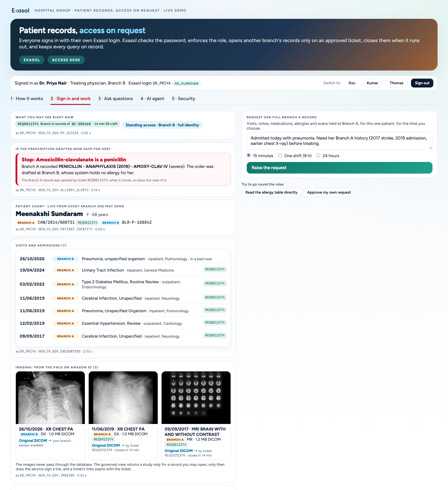
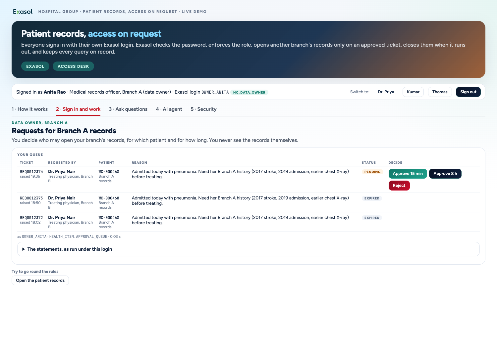
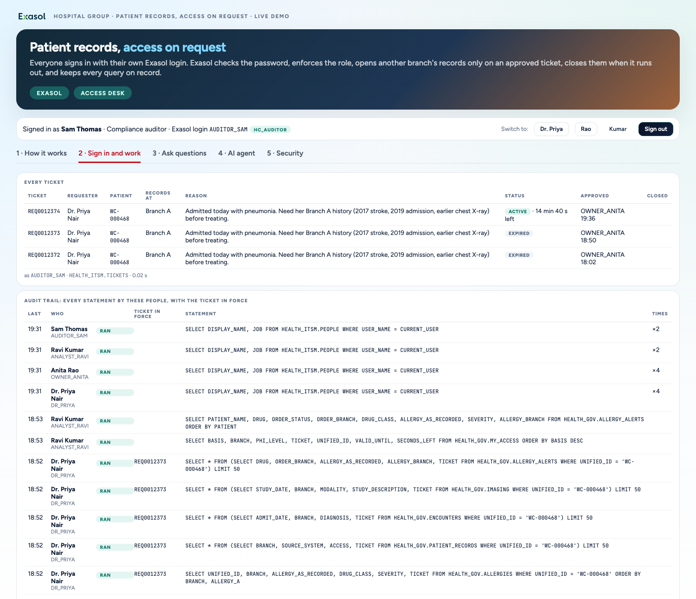
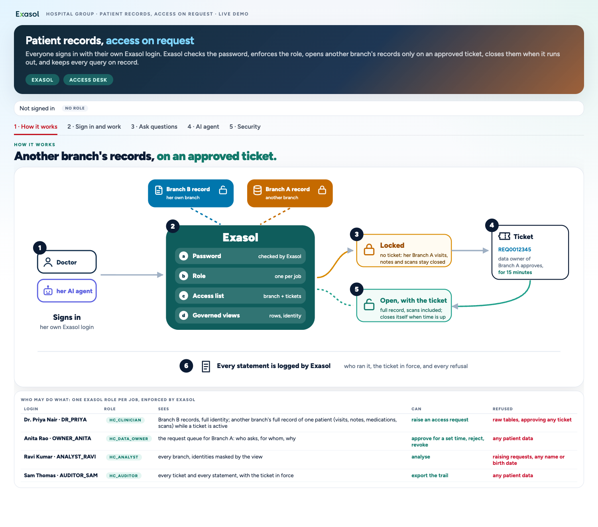
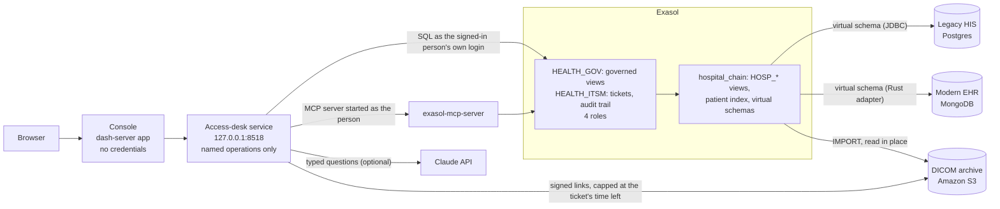

# Healthcare with governance on Exasol

Patient records with **access on request**. A doctor needs a patient's records from another branch: today that means a
phone call, a shared password, or a copy that never goes away. Here every person signs in with their **own Exasol
login**, **one role per job** decides what they can read and do, and another branch's records open only on a
**ticket** that branch's data owner approved, for one patient and a set time. The view checks the expiry on every
query. Exasol's **audit log** shows every statement, refusals included, with the ticket in force. An **AI agent** (the
real `exasol-mcp-server`) signs in as the person and gets exactly their access. Nothing in the rules lives in the app.

It is built on top of **[hospital_chain](https://github.com/yuvi-ex/hospital_chain)**: three branch systems (a legacy
hospital information system on Postgres, a modern health record on MongoDB, DICOM images on Amazon S3) that Exasol
reads in place and ties to one person with a patient index. This repository adds the access layer and its own console,
reads hospital_chain's views and changes nothing there.



## What you see

| Tab | What it shows |
|---|---|
| 1 How it works | one picture: who asks, the request, the approval, the record opening, the expiry, the audit trail |
| 2 Sign in and work | sign in as one of four people. **Dr. Priya** sees her own branch; the other branch's record is **locked** and reading the table directly is refused. She raises a request; **Anita** (data owner) approves it for 15 minutes and is refused when she tries to read patient data herself; Dr. Priya's chart now opens in full: visits, notes, medicines, scans from S3 and the penicillin allergy, so the alert fires. **Ravi** (analyst) sees every branch with names masked. **Sam** (auditor) sees every ticket and every statement with the ticket in force |
| 3 Ask questions | six fixed questions and a free-text box, each answered **as the signed-in person**, so the answer depends on who asks. Under every answer, "Why you see this": what came from the job, what came from a ticket, what was hidden |
| 4 AI agent | the real Exasol MCP server, signed in as the person, summarises the patient's full history: with a ticket it sees everything, without one it cannot |
| 5 Security | four checks in one central Exasol on every request, the systems read in place, the audit log under all of it |







## The people

| Login | Person | Role | Sees | Can |
|---|---|---|---|---|
| `DR_PRIYA` | Dr. Priya Nair, treating physician, Branch B | `HC_CLINICIAN` | Branch B in full; another branch's full record of one patient while a ticket is open | raise a request |
| `OWNER_ANITA` | Anita Rao, records officer, Branch A | `HC_DATA_OWNER` | the request queue for Branch A; no patient data | approve for a set time, reject, revoke |
| `ANALYST_RAVI` | Ravi Kumar, quality analyst | `HC_ANALYST` | every branch, names masked | analyse; no named requests |
| `AUDITOR_SAM` | Sam Thomas, compliance auditor | `HC_AUDITOR` | every ticket and every statement; no patient data | read the trail |

The patient is Meenakshi Sundaram, 68: anaphylaxis to penicillin recorded years ago at Branch A, admitted today at
Branch B, where no allergy is on file, with a penicillin just drafted.

## Architecture



The console holds no credentials and opens no database session: dash-server forbids it, so every action goes through
the access-desk service, which accepts named operations only (never SQL from the page) and opens a session **as the
signed-in person**. What anyone may see or do is decided by Exasol: roles, the governed views and the ticket rules.

How the rules are built:

- **Governed views** (`HEALTH_GOV`) filter every record by the caller's standing access (by job and branch) plus any
  active ticket, mask names for the analyst, and carry their definition in `COMMENT IS`, which is what an AI client
  reads before it writes SQL.
- **Tickets are append-only.** Requests and decisions are inserted, never updated. A decision counts only if it came
  from a data owner of that branch who is not the requester, so a forged row grants nothing.
- **Expiry is checked on every query** against `SYSTIMESTAMP`, the clock the audit log uses. Scan links are signed only
  for keys the view returned, and expire with the ticket.
- **The audit trail** is Exasol's own audit log, joined to the ticket that was in force for each statement.
- **Typed questions:** Claude sees only the catalogue of views this login can read and writes one read-only query;
  a guard rejects anything but a single SELECT, and Exasol runs it as the person. Safety never depends on the model.

## Data

This project adds no patient data of its own. It reads hospital_chain's synthetic patients (1,200 people, 1,609 records
across the three systems) and its real, de-identified images, and stores only:

| Object | Contents |
|---|---|
| `HEALTH_ITSM.PEOPLE`, `STANDING_ACCESS`, `DATA_OWNERS` | the four people, what each job sees by default, who owns which branch |
| `HEALTH_ITSM.REQUESTS`, `DECISIONS` | tickets: requests and approvals, rejections, revocations (append-only) |
| `HEALTH_ITSM.DEMO_EPOCH` | when the audit trail starts (set by a reset) |

## Prerequisites

Tested on **macOS on Apple silicon**.

- **[hospital_chain](https://github.com/yuvi-ex/hospital_chain), built and passing its preflight.** That brings
  Exasol Personal (`exakit`, with `~/.exapump/config.toml` profile `starter-kit`), the dash-server add-on, the branch
  systems, the images on S3 and the read-only S3 key. By default this project looks for it in `../hospital_chain`.
- **uv** (`brew install uv`) for the Python environment, and `uvx` (part of uv) to run the MCP server.
- **Optional:** an Anthropic API key for typed questions. Without it the six questions, the tickets, the agent and the
  audit trail all work; the free-text box says Claude is not set up.
- **Optional:** Google Chrome for the browser tests.

## Install

```sh
# next to your hospital_chain checkout
git clone https://github.com/yuvi-ex/healthcare_with_governance.git
cd healthcare_with_governance

# optional, for typed questions
mkdir -p secrets && cp anthropic.env.example secrets/anthropic.env && chmod 600 secrets/anthropic.env
# then put your key after ANTHROPIC_API_KEY= in secrets/anthropic.env

setup/build_all.sh
```

It takes about a minute. Every step can be re-run; to resume after a failure: `setup/build_all.sh <step>`. At the end
it prints **GO** and the console address, by default http://127.0.0.1:5100/apps/health-access/.

What the installer does, in order:

0. Creates `.venv` from `requirements.txt`.
1. Checks that hospital_chain's objects are in Exasol and that its S3 bucket and read-only key are configured.
2. Creates the access layer (`sql/*.sql`, in order): `HEALTH_ITSM`, `HEALTH_GOV`, the four roles and their grants;
   then the four logins, with passwords generated into `secrets/hc_users.env` (mode 600, git-ignored) and never printed.
3. Checks for the Claude key (optional).
4. Starts the access-desk service.
5. Deploys the console to dash-server.
6. Runs the preflight with a clean start (no tickets, audit trail from now).

## Configuration

`config.env` holds every setting: where hospital_chain is (`HC_BASE_DIR`), the Exasol address, the service port, the
console name, the Claude model. To change one, put it in `config.local.env` (git-ignored), for example:

```sh
HC_BASE_DIR=/path/to/hospital_chain
HC_GOV_SERVICE_PORT=8600
HC_GOV_APP=access-demo
```

The S3 bucket, region and read-only key are read from hospital_chain's own settings, so both projects always use the
same ones. The database objects of this project are `HEALTH_ITSM`, `HEALTH_GOV`, the roles `HC_*` and the four logins
above; hospital_chain's are all `HOSP_*`.

## Day to day

| Task | Command |
|---|---|
| Before a demo: GO / NO-GO | `../hospital_chain/setup/preflight.sh`, then `setup/preflight.sh --reset` (`--reset` clears every ticket and restarts the audit trail: do it right before the demo, not during) |
| Back to the starting state | `.venv/bin/python setup/reset.py` |
| Start the access-desk service | `service/run.sh` (log: `.work/itsm_api.log`) |
| Restart it (sign-ins hang) | `pkill -f "$PWD/service/itsm_api.py"; service/run.sh` |
| Redeploy the console after a change | `.venv/bin/python dash/deploy.py` |
| Browser test of the whole story | `.venv/bin/python tools/story.py .work/shots`, then `setup/preflight.sh --reset` |
| Browser test of the questions tab | `.venv/bin/python tools/qa_test.py .work/shots`, then `setup/preflight.sh --reset` |
| Remove everything this project created | `setup/uninstall.sh --yes` (hospital_chain is not touched) |

## Repository layout

| Path | What |
|---|---|
| `sql/` | `10_itsm.sql`: tickets, people, access rules, governed views, audit trail, roles. `20_chart.sql`: the whole chart, record by record (identity, visits, notes read live from Postgres and MongoDB, medications, imaging). `30_questions.sql`: the views behind the six questions |
| `setup/` | `build_all.sh` (installer), `venv.sh`, `01_access.py` (access layer and logins), `reset.py`, `preflight.sh`, `uninstall.sh` |
| `service/` | the access desk: `itsm_api.py` (HTTP, loopback only), `ops.py` (every operation, as the signed-in person; at most 6 sessions), `agent.py` (MCP server as the person), `freeask.py` (typed questions with Claude) |
| `dash/` | the console (Dash on dash-server) and `deploy.py` |
| `tools/` | headless browser tests with screenshots: `story.py`, `qa_test.py` |
| `docs/` | the screenshots in this README |
| `config.env`, `hcconfig.py` | settings, read by the shell scripts and the Python code |

## Things that will bite

- **Session cap:** Exasol Personal allows 20 sessions for everything on the machine (both demos and dash-server). The
  access desk never holds more than 6. If sign-ins hang with `08004`, restart the service; if that is not enough,
  restart dash-server: `exakit stop dash-server && exakit start dash-server`.
- **Clocks:** expiry and the audit trail use `SYSTIMESTAMP` (UTC). Do not switch to `CURRENT_TIMESTAMP`, which follows
  the session time zone and makes tickets look an hour off.
- **VM clock:** if scans stop showing or S3 answers 403, the Exasol VM's clock has drifted: run hospital_chain's
  `setup/preflight.sh`, which resyncs it.
- **The MCP server wraps queries** as `SELECT * FROM (…) LIMIT n`; an `ORDER BY` inside stops the filter reaching the
  branch systems (23 s instead of 1 s). The agent's queries sort in Python.
- **Typed questions need internet** and a key; the preflight only warns when Claude is not reachable.
- **Keep the laptop awake** during a demo (`caffeinate -i …`); a sleeping machine looks like a hang.

## If asked: what changes in production

- **Whoever runs the database** can still change the rules. In production a separate team holds that job, and the record
  of every check is also kept outside the database.
- **Tickets live in Exasol here.** In production the service desk (ServiceNow, Jira Service Management, …) raises and
  closes them and tells Exasol; the views stay the same.
- **Passwords here.** In production staff sign in with their company login (single sign-on); Exasol still sees the
  person, never a shared account.

## What is real

Exasol, the logins, roles, governed views, ticket rules, audit log, the MCP server and the Claude calls are real and
running, as are hospital_chain's virtual schemas over Postgres, MongoDB and S3. The patients, visits, notes and
prescriptions are synthetic; no real person or hospital is involved. The medical images are real, de-identified studies
from The Cancer Imaging Archive (CC BY 4.0), relabelled to the synthetic patients.

## License

MIT, see [LICENSE](LICENSE).
